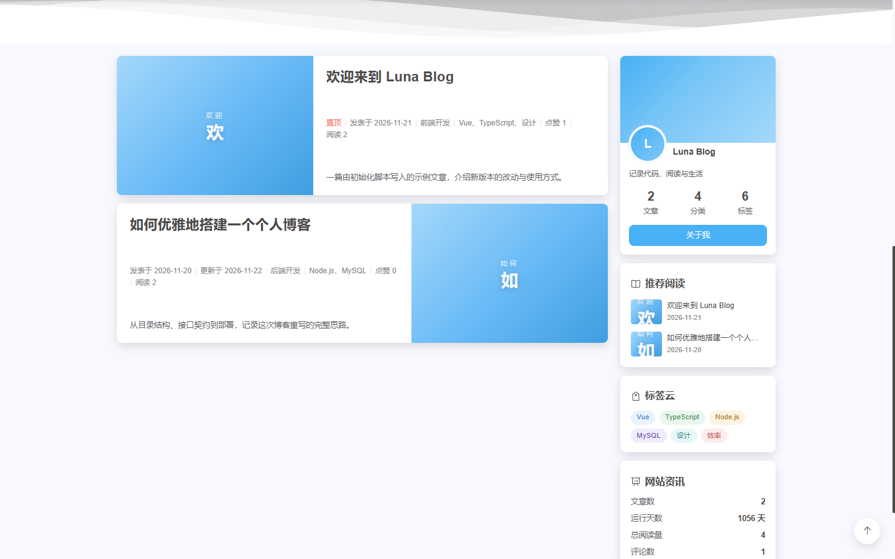
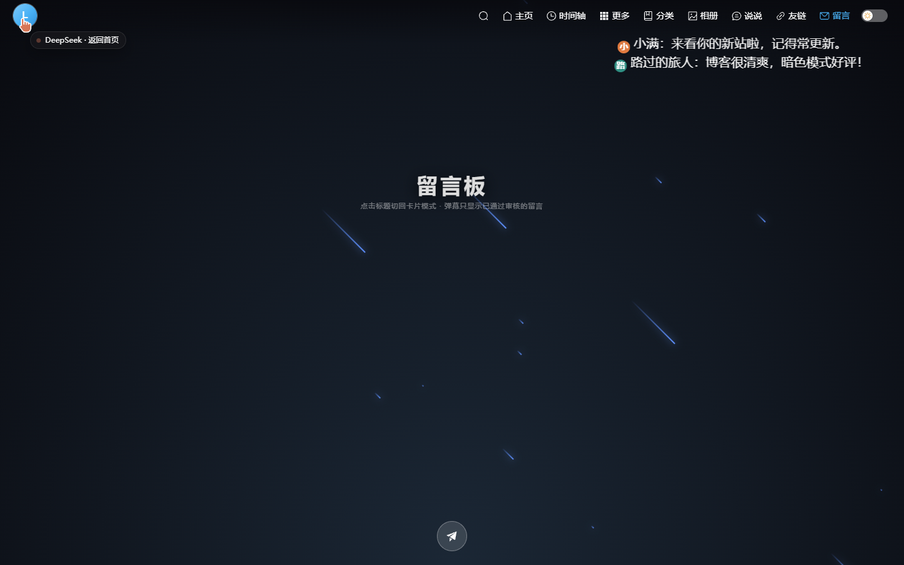
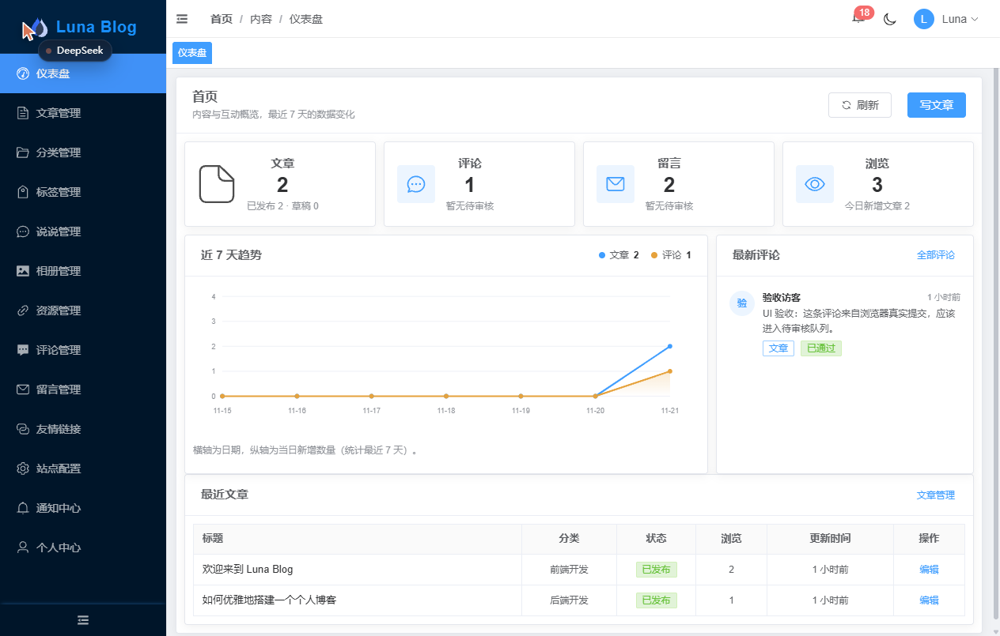

# Luna Blog

> 从零重写的个人博客系统：**博客前台** + **管理后台** + **API 服务**，一套代码、三种形态、一键发布。

[](https://github.com/FurinaLuna/luna-blog/actions/workflows/deploy-docker.yml)
[](https://nodejs.org)
[](https://vuejs.org)
[](https://docs.docker.com/compose/)

访客**无需注册即可评论**（默认进审核队列），只有管理员登录后台；前台以阅读体验为先，后台以内容维护效率为先，
接口契约、数据模型与视觉规范全部文档化。视觉沿用原型、代码全部重写，技术栈全新，便于从旧站平滑迁移。


## 预览

| 首页列表 | 文章详情 |
| --- | --- |
|  |  |
| **留言板（弹幕）** | **相册** |
|  |  |
| **后台仪表盘** | **分类页** |
|  |  |

## 功能

**前台**：分页文章列表 + 推荐位、Markdown 详情（代码高亮 / 目录 / 点赞 / 评论）、分类 / 标签 / 时间轴 / 搜索 /
RSS、说说、相册（照片墙 + 大图预览）、留言墙（默认整屏夜空弹幕，可切彩色卡片）、资源、友链、关于、404；
全屏天空首页、波浪过渡、常驻唱片球音乐播放器、站点运行时长与访问量统计。

**后台**：登录 + 首次登录强制改密、仪表盘、文章（md-editor-v3 编辑 / 草稿 / 发布 / 推荐）、分类、标签、
评论审核与回复、说说、相册、留言审核、资源、友链、站点配置（含 15 个页面横幅、关于页 Markdown、导航外链、音乐）、
通知中心、个人中心。

**服务端**：Koa 3 + Sequelize 6 + MySQL 8，JWT 鉴权、限频、敏感词、图片/音频上传、RSS、统一错误响应。

## 技术栈

| 层 | 选型 |
| --- | --- |
| 前台 / 后台 | Vue 3.5 · Vite 8 · TypeScript 7 · Vue Router 5 · Pinia 4 · Element Plus 2.14 · Tailwind CSS 4 |
| 内容渲染 | md-editor-v3 7（预览 / 目录 / 编辑）· vue3-danmaku 1.6（弹幕）· @pinia/colada（请求缓存） |
| 服务端 | Koa 3 · @koa/router 15 · Sequelize 6 · mysql2 · zod 4 · jsonwebtoken 9 · bcryptjs 3 |
| 运维 | Docker Compose（web / api / db）· GitHub Actions → GHCR → 服务器切 tag · systemd 定时备份 |

依赖版本全部锁定在各自 `package.json`（不使用 `^` / `~`），锁文件一并提交。

## 架构

```
浏览器 ── HTTP:80 ──> web 容器 (nginx)
                       ├─ /            前台 SPA 静态
                       ├─ /admin/      后台 SPA 静态（仅内网，SSH 隧道访问）
                       ├─ /uploads/    图片与附件
                       └─ /api, /rss.xml, /sitemap.xml ──> api 容器 (Koa:3000) ──> db 容器 (MySQL 8)
```

## 目录结构

```
luna-blog/
├── blog-web/          # 前台（Vue SPA，开发端口 5173）
├── blog-admin/        # 后台（Vue SPA，开发端口 5174）
├── blog-server/       # API 服务（Koa，端口 3000）
│   ├── src/{config,core,db,middleware,modules,routes}
│   └── scripts/       # db:init 初始化、build 静态检查
├── docker/            # api/web 镜像与容器内 nginx 配置
├── deploy/            # docker-compose、运维脚本、systemd 单元（宿主部署样例见 RUNBOOK 附录）
├── docs/              # API / DESIGN / PROTOTYPE / RUNBOOK / 项目评审
└── scripts/smoke-api.mjs   # 端到端接口冒烟（33 项断言）
```

## 本地运行

```bash
# 1. 依赖（Node >= 22.12、pnpm 10+、MySQL 8）
pnpm -C blog-server install && pnpm -C blog-web install && pnpm -C blog-admin install

# 2. 环境变量：DB_* / JWT_SECRET / ADMIN_PASSWORD / SITE_URL / CORS_ORIGINS
cp blog-server/.env.example blog-server/.env

# 3. 建库 + 初始化管理员（不带示例文章）
pnpm -C blog-server db:init

# 4. 三个终端分别启动
pnpm -C blog-server dev     # http://127.0.0.1:3000
pnpm -C blog-web dev        # http://localhost:5173
pnpm -C blog-admin dev      # http://localhost:5174

# 5. 冒烟（可选）
node scripts/smoke-api.mjs
```

首次登录后台会被强制改密；改密后旧令牌立即失效（JWT 内带 `tokenVersion`）。

## 部署

生产是 Docker Compose 三容器：`web`（nginx + 两个 SPA）、`api`（Node/Koa）、`db`（MySQL 8）。
运维细节（发布、回滚、备份恢复、后台隧道、排障）见 [`docs/ops/RUNBOOK.md`](docs/ops/RUNBOOK.md) 第 0 章。

```bash
git push      # 命中 paths 过滤 → 构建镜像推 GHCR → SSH 切 tag → /api/health 校验（失败自动回滚）
```

手工操作：

```bash
cd /var/www/luna-blog
sudo docker compose --env-file compose.env --env-file images.env ps          # 状态
sudo bash src/deploy/ops/docker-release.sh <tag>                            # 切镜像 tag
sudo bash src/deploy/ops/backup-docker.sh                                   # 备份（每日 03:30 自动）
ssh -L 8080:127.0.0.1:8080 ubuntu@<server>                                  # 后台隧道 → http://127.0.0.1:8080/admin/
```

## 文档

| 文档 | 内容 |
| --- | --- |
| [`docs/API.md`](docs/API.md) | 全部接口：响应包、分页、鉴权与错误码、限频表、表结构 |
| [`docs/DESIGN.md`](docs/DESIGN.md) | 视觉与交互规范：前后台 token、布局、页面结构 |
| [`docs/PROTOTYPE-web.md`](docs/PROTOTYPE-web.md) · [`docs/PROTOTYPE-admin.md`](docs/PROTOTYPE-admin.md) | 原型档案：尺寸、动画、素材清单 |
| [`docs/ops/RUNBOOK.md`](docs/ops/RUNBOOK.md) | 生产运维手册（Docker Compose 章节 + 宿主部署 legacy） |
| [`docs/PROJECT-REVIEW.md`](docs/PROJECT-REVIEW.md) | 项目全面评审与整改记录 |

改接口先改 `docs/API.md`，改样式先改 `docs/DESIGN.md`，再同步实现。

## 设计取舍与踩坑

- **音乐播放器走 Meting API**：后台选平台（网易云 / QQ）+ 歌单 id，元数据与直链实时取，不需要自建服务；
  QQ 直链要求解析端在国内，公共海外实例只列歌单，失效时唱片球提示「暂无可用音源」。
- **TypeScript 7 与 vue-tsc 不兼容**：`.ts` 用 `typescript@7`，`.vue` 用官方兼容包 `typescript6` 作 vue-tsc 宿主。
- **`vue3-danmaku@1.6.7` 的类型声明大小写错误**（`danmaku.vue.d.ts` vs 实际 `Danmaku.vue.d.ts`）：
  由 `blog-web/src/types/vue3-danmaku.d.ts` 兜底，否则 Linux CI 构建报 TS7016。
- **模板里别裸写含 `//` 的 URL**：`vue-tsc` 会把 `placeholder="https://…"` 当行注释，改用 `:placeholder` + 常量。
- **弹幕容器必须有显式高度**，内容先转义再拼 `span`；两个 SPA 都是 history 路由，nginx 需 `try_files` 回退。
- **首页天空不依赖图床**：CSS 多层渐变叠加本地 `clouds.png`，离线可用。

## License

个人项目，仅供学习参考。
