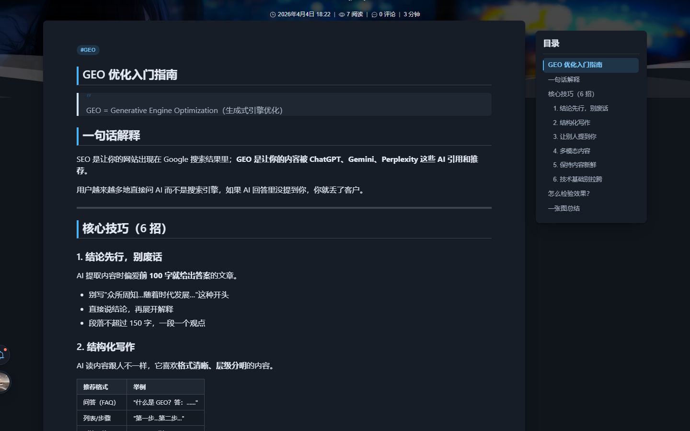

# Luna Blog

> 浠庨浂閲嶅啓鐨勪釜浜哄崥瀹㈢郴缁燂細**鍗氬鍓嶅彴** + **绠＄悊鍚庡彴** + **API 鏈嶅姟**锛屼竴濂椾唬鐮併€佷笁绉嶅舰鎬併€佷竴閿彂甯冦€?
[](https://github.com/FurinaLuna/luna-blog/actions/workflows/deploy-docker.yml)
[](https://nodejs.org)
[](https://vuejs.org)
[](https://docs.docker.com/compose/)

璁垮**鏃犻渶娉ㄥ唽鍗冲彲璇勮**锛堥粯璁よ繘瀹℃牳闃熷垪锛夛紝鍙湁绠＄悊鍛樼櫥褰曞悗鍙帮紱鍓嶅彴浠ラ槄璇讳綋楠屼负鍏堬紝鍚庡彴浠ュ唴瀹圭淮鎶ゆ晥鐜囦负鍏堬紝
鎺ュ彛濂戠害銆佹暟鎹ā鍨嬩笌瑙嗚瑙勮寖鍏ㄩ儴鏂囨。鍖栥€傝瑙夋部鐢ㄥ師鍨嬨€佷唬鐮佸叏閮ㄩ噸鍐欙紝鎶€鏈爤鍏ㄦ柊锛屼究浜庝粠鏃х珯骞虫粦杩佺Щ銆?


## 棰勮

| 棣栭〉鍒楄〃 | 鏂囩珷璇︽儏 |
| --- | --- |
|  |  |
| **鐣欒█鏉匡紙寮瑰箷锛?* | **鐩稿唽** |
|  |
| **鍚庡彴浠〃鐩?* | **鍒嗙被椤?* |
| ![鍚庡彴浠〃鐩榏(docs/screenshots/admin-dashboard.png) | ![鍒嗙被椤礭(docs/screenshots/categories.png) |

## 鍔熻兘

**鍓嶅彴**锛氬垎椤垫枃绔犲垪琛?+ 鎺ㄨ崘浣嶃€丮arkdown 璇︽儏锛堜唬鐮侀珮浜?/ 鐩綍 / 鐐硅禐 / 璇勮锛夈€佸垎绫?/ 鏍囩 / 鏃堕棿杞?/ 鎼滅储 /
RSS銆佽璇淬€佺浉鍐岋紙鐓х墖澧?+ 澶у浘棰勮锛夈€佺暀瑷€澧欙紙榛樿鏁村睆澶滅┖寮瑰箷锛屽彲鍒囧僵鑹插崱鐗囷級銆佽祫婧愩€佸弸閾俱€佸叧浜庛€?04锛?鍏ㄥ睆澶╃┖棣栭〉銆佹尝娴繃娓°€佸父椹诲敱鐗囩悆闊充箰鎾斁鍣ㄣ€佺珯鐐硅繍琛屾椂闀夸笌璁块棶閲忕粺璁°€?
**鍚庡彴**锛氱櫥褰?+ 棣栨鐧诲綍寮哄埗鏀瑰瘑銆佷华琛ㄧ洏銆佹枃绔狅紙md-editor-v3 缂栬緫 / 鑽夌 / 鍙戝竷 / 鎺ㄨ崘锛夈€佸垎绫汇€佹爣绛俱€?璇勮瀹℃牳涓庡洖澶嶃€佽璇淬€佺浉鍐屻€佺暀瑷€瀹℃牳銆佽祫婧愩€佸弸閾俱€佺珯鐐归厤缃紙鍚?15 涓〉闈㈡í骞呫€佸叧浜庨〉 Markdown銆佸鑸閾俱€侀煶涔愶級銆?閫氱煡涓績銆佷釜浜轰腑蹇冦€?
**鏈嶅姟绔?*锛欿oa 3 + Sequelize 6 + MySQL 8锛孞WT 閴存潈銆侀檺棰戙€佹晱鎰熻瘝銆佸浘鐗?闊抽涓婁紶銆丷SS銆佺粺涓€閿欒鍝嶅簲銆?
## 鎶€鏈爤

| 灞?| 閫夊瀷 |
| --- | --- |
| 鍓嶅彴 / 鍚庡彴 | Vue 3.5 路 Vite 8 路 TypeScript 7 路 Vue Router 5 路 Pinia 4 路 Element Plus 2.14 路 Tailwind CSS 4 |
| 鍐呭娓叉煋 | md-editor-v3 7锛堥瑙?/ 鐩綍 / 缂栬緫锛壜?vue3-danmaku 1.6锛堝脊骞曪級路 @pinia/colada锛堣姹傜紦瀛橈級 |
| 鏈嶅姟绔?| Koa 3 路 @koa/router 15 路 Sequelize 6 路 mysql2 路 zod 4 路 jsonwebtoken 9 路 bcryptjs 3 |
| 杩愮淮 | Docker Compose锛坵eb / api / db锛壜?GitHub Actions 鈫?GHCR 鈫?鏈嶅姟鍣ㄥ垏 tag 路 systemd 瀹氭椂澶囦唤 |

渚濊禆鐗堟湰鍏ㄩ儴閿佸畾鍦ㄥ悇鑷?`package.json`锛堜笉浣跨敤 `^` / `~`锛夛紝閿佹枃浠朵竴骞舵彁浜ゃ€?
## 鏋舵瀯

```
娴忚鍣?鈹€鈹€ HTTP:80 鈹€鈹€> web 瀹瑰櫒 (nginx)
                       鈹溾攢 /            鍓嶅彴 SPA 闈欐€?                       鈹溾攢 /admin/      鍚庡彴 SPA 闈欐€侊紙浠呭唴缃戯紝SSH 闅ч亾璁块棶锛?                       鈹溾攢 /uploads/    鍥剧墖涓庨檮浠?                       鈹斺攢 /api, /rss.xml, /sitemap.xml 鈹€鈹€> api 瀹瑰櫒 (Koa:3000) 鈹€鈹€> db 瀹瑰櫒 (MySQL 8)
```

## 鐩綍缁撴瀯

```
luna-blog/
鈹溾攢鈹€ blog-web/          # 鍓嶅彴锛圴ue SPA锛屽紑鍙戠鍙?5173锛?鈹溾攢鈹€ blog-admin/        # 鍚庡彴锛圴ue SPA锛屽紑鍙戠鍙?5174锛?鈹溾攢鈹€ blog-server/       # API 鏈嶅姟锛圞oa锛岀鍙?3000锛?鈹?  鈹溾攢鈹€ src/{config,core,db,middleware,modules,routes}
鈹?  鈹斺攢鈹€ scripts/       # db:init 鍒濆鍖栥€乥uild 闈欐€佹鏌?鈹溾攢鈹€ docker/            # api/web 闀滃儚涓庡鍣ㄥ唴 nginx 閰嶇疆
鈹溾攢鈹€ deploy/            # docker-compose銆佽繍缁磋剼鏈€乻ystemd 鍗曞厓锛堝涓婚儴缃叉牱渚嬭 RUNBOOK 闄勫綍锛?鈹溾攢鈹€ docs/              # API / DESIGN / PROTOTYPE / RUNBOOK / 椤圭洰璇勫
鈹斺攢鈹€ scripts/smoke-api.mjs   # 绔埌绔帴鍙ｅ啋鐑燂紙33 椤规柇瑷€锛?```

## 鏈湴杩愯

```bash
# 1. 渚濊禆锛圢ode >= 22.12銆乸npm 10+銆丮ySQL 8锛?pnpm -C blog-server install && pnpm -C blog-web install && pnpm -C blog-admin install

# 2. 鐜鍙橀噺锛欴B_* / JWT_SECRET / ADMIN_PASSWORD / SITE_URL / CORS_ORIGINS
cp blog-server/.env.example blog-server/.env

# 3. 寤哄簱 + 鍒濆鍖栫鐞嗗憳锛堜笉甯︾ず渚嬫枃绔狅級
pnpm -C blog-server db:init

# 4. 涓変釜缁堢鍒嗗埆鍚姩
pnpm -C blog-server dev     # http://127.0.0.1:3000
pnpm -C blog-web dev        # http://localhost:5173
pnpm -C blog-admin dev      # http://localhost:5174

# 5. 鍐掔儫锛堝彲閫夛級
node scripts/smoke-api.mjs
```

棣栨鐧诲綍鍚庡彴浼氳寮哄埗鏀瑰瘑锛涙敼瀵嗗悗鏃т护鐗岀珛鍗冲け鏁堬紙JWT 鍐呭甫 `tokenVersion`锛夈€?
## 閮ㄧ讲

鐢熶骇鏄?Docker Compose 涓夊鍣細`web`锛坣ginx + 涓や釜 SPA锛夈€乣api`锛圢ode/Koa锛夈€乣db`锛圡ySQL 8锛夈€?杩愮淮缁嗚妭锛堝彂甯冦€佸洖婊氥€佸浠芥仮澶嶃€佸悗鍙伴毀閬撱€佹帓闅滐級瑙?[`docs/ops/RUNBOOK.md`](docs/ops/RUNBOOK.md) 绗?0 绔犮€?
```bash
git push      # 鍛戒腑 paths 杩囨护 鈫?鏋勫缓闀滃儚鎺?GHCR 鈫?SSH 鍒?tag 鈫?/api/health 鏍￠獙锛堝け璐ヨ嚜鍔ㄥ洖婊氾級
```

鎵嬪伐鎿嶄綔锛?
```bash
cd /var/www/luna-blog
sudo docker compose --env-file compose.env --env-file images.env ps          # 鐘舵€?sudo bash src/deploy/ops/docker-release.sh <tag>                            # 鍒囬暅鍍?tag
sudo bash src/deploy/ops/backup-docker.sh                                   # 澶囦唤锛堟瘡鏃?03:30 鑷姩锛?ssh -L 8080:127.0.0.1:8080 ubuntu@<server>                                  # 鍚庡彴闅ч亾 鈫?http://127.0.0.1:8080/admin/
```

## 鏂囨。

| 鏂囨。 | 鍐呭 |
| --- | --- |
| [`docs/API.md`](docs/API.md) | 鍏ㄩ儴鎺ュ彛锛氬搷搴斿寘銆佸垎椤点€侀壌鏉冧笌閿欒鐮併€侀檺棰戣〃銆佽〃缁撴瀯 |
| [`docs/DESIGN.md`](docs/DESIGN.md) | 瑙嗚涓庝氦浜掕鑼冿細鍓嶅悗鍙?token銆佸竷灞€銆侀〉闈㈢粨鏋?|
| [`docs/PROTOTYPE-web.md`](docs/PROTOTYPE-web.md) 路 [`docs/PROTOTYPE-admin.md`](docs/PROTOTYPE-admin.md) | 鍘熷瀷妗ｆ锛氬昂瀵搞€佸姩鐢汇€佺礌鏉愭竻鍗?|
| [`docs/ops/RUNBOOK.md`](docs/ops/RUNBOOK.md) | 鐢熶骇杩愮淮鎵嬪唽锛圖ocker Compose 绔犺妭 + 瀹夸富閮ㄧ讲 legacy锛?|
| [`docs/reference-backend.md`](docs/reference-backend.md) 路 [`docs/reference-frontend.md`](docs/reference-frontend.md) | 鏃х珯鎺ュ彛涓庡墠绔疄鐜板弬鑰冿紙閲嶅啓鏃剁殑瀵圭収璧勬枡锛?|
| [`docs/PROJECT-REVIEW.md`](docs/PROJECT-REVIEW.md) | 椤圭洰鍏ㄩ潰璇勫涓庢暣鏀硅褰?|

鏀规帴鍙ｅ厛鏀?`docs/API.md`锛屾敼鏍峰紡鍏堟敼 `docs/DESIGN.md`锛屽啀鍚屾瀹炵幇銆?
## 璁捐鍙栬垗涓庤俯鍧?
- **闊充箰鎾斁鍣ㄨ蛋 Meting API**锛氬悗鍙伴€夊钩鍙帮紙缃戞槗浜?/ QQ锛? 姝屽崟 id锛屽厓鏁版嵁涓庣洿閾惧疄鏃跺彇锛屼笉闇€瑕佽嚜寤烘湇鍔★紱
  QQ 鐩撮摼瑕佹眰瑙ｆ瀽绔湪鍥藉唴锛屽叕鍏辨捣澶栧疄渚嬪彧鍒楁瓕鍗曪紝澶辨晥鏃跺敱鐗囩悆鎻愮ず銆屾殏鏃犲彲鐢ㄩ煶婧愩€嶃€?- **TypeScript 7 涓?vue-tsc 涓嶅吋瀹?*锛歚.ts` 鐢?`typescript@7`锛宍.vue` 鐢ㄥ畼鏂瑰吋瀹瑰寘 `typescript6` 浣?vue-tsc 瀹夸富銆?- **`vue3-danmaku@1.6.7` 鐨勭被鍨嬪０鏄庡ぇ灏忓啓閿欒**锛坄danmaku.vue.d.ts` vs 瀹為檯 `Danmaku.vue.d.ts`锛夛細
  鐢?`blog-web/src/types/vue3-danmaku.d.ts` 鍏滃簳锛屽惁鍒?Linux CI 鏋勫缓鎶?TS7016銆?- **妯℃澘閲屽埆瑁稿啓鍚?`//` 鐨?URL**锛歚vue-tsc` 浼氭妸 `placeholder="https://鈥?` 褰撹娉ㄩ噴锛屾敼鐢?`:placeholder` + 甯搁噺銆?- **寮瑰箷瀹瑰櫒蹇呴』鏈夋樉寮忛珮搴?*锛屽唴瀹瑰厛杞箟鍐嶆嫾 `span`锛涗袱涓?SPA 閮芥槸 history 璺敱锛宯ginx 闇€ `try_files` 鍥為€€銆?- **棣栭〉澶╃┖涓嶄緷璧栧浘搴?*锛欳SS 澶氬眰娓愬彉鍙犲姞鏈湴 `clouds.png`锛岀绾垮彲鐢ㄣ€?
## License

涓汉椤圭洰锛屼粎渚涘涔犲弬鑰冦€?