# Luna Blog · FurinaLuna 的个人博客

<p align="center">
  <b>一个从零重写的三端分离个人博客</b><br/>
  沉浸式阅读前台 · 纯管理后台 · Koa API 服务端 · Docker Compose 部署 · GitHub Actions 自动发布
</p>

<p align="center">
  <a href="https://github.com/FurinaLuna/luna-blog/actions/workflows/deploy-docker.yml"></a>
  
  
  
  
  
  
</p>

<p align="center">
  🌐 <a href="http://43.143.72.12"><b>在线预览</b></a>（HTTP · 域名备案中）
  &nbsp;|&nbsp; 📖 <a href="docs/DESIGN.md">设计文档</a>
  &nbsp;|&nbsp; 🚀 <a href="docs/ops/RUNBOOK.md">运维手册</a>
  &nbsp;|&nbsp; 🧩 <a href="docs/API.md">接口文档</a>
</p>

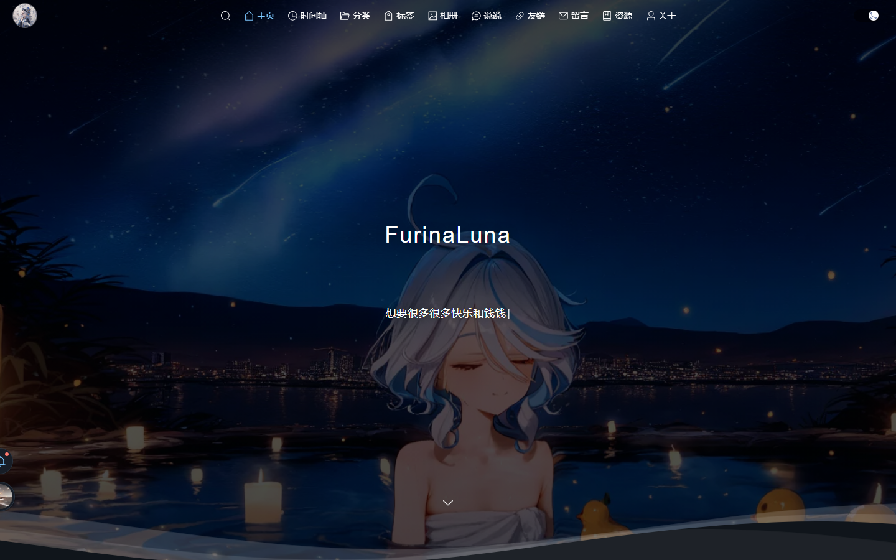

## ✨ 特性一览

| 前台（读者） | 后台（站长） | 服务端 / 工程 |
| --- | --- | --- |
| 沉浸式首页：全屏横幅 + 波浪过渡 + 打字机副标题 | 仪表盘：文章/评论/留言/浏览统计 + 近 7 天趋势 | Koa 3 + Sequelize 6 + MySQL 8，清晰分层 |
| 文章：Markdown 渲染、代码高亮与行号、一键复制、自动目录 | 文章：草稿/发布、置顶、推荐、阅读时长、封面 | JWT 登录、bcrypt 密码、首登强制改密、改密使旧 token 失效 |
| 评论：免登录（昵称 + 邮箱）、审核后展示、楼中楼回复 | 评论/留言：审核、回复、批量通过/拒绝/删除 | 全站限频（通用/写操作/登录）、上传类型与大小校验 |
| 留言板：弹幕 + 卡片双模式，可自定义颜色 | 分类/标签/说说/相册/资源/友链 全量 CRUD | 统一响应与错误码、zod 请求校验、访问统计 PV/UV |
| 归档时间轴、分类与标签聚合、全文搜索 | 站点配置：TDK、页面横幅、资料卡、页脚、社交、音乐、欢迎语、登录页背景 | RSS、Sitemap、robots.txt、llms.txt、文章 Markdown 直出 |
| 相册瀑布、说说、友链、资源导航、关于页 | 通知中心：评论/留言/友链提醒，已读与清理 | 健康检查 `/api/health`、Docker 多阶段构建、镜像经 GHCR 分发 |
| 深浅色主题、可配置横幅与社交图标、音乐唱片球 | 媒体库上传（图片/音频）、Markdown 编辑器（Mermaid/KaTeX） | GitHub Actions：`push` 即构建镜像 → 部署 → 健康检查 → 失败自动回滚 |

## 🖼 界面预览

<table>
  <tr>
    <td width="50%"></td>
    <td width="50%">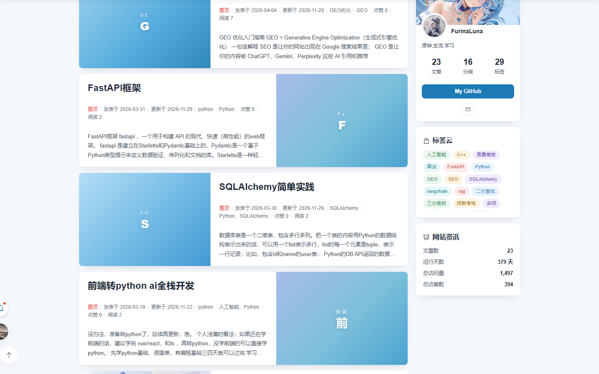</td>
  </tr>
  <tr>
    <td width="50%"></td>
    <td width="50%">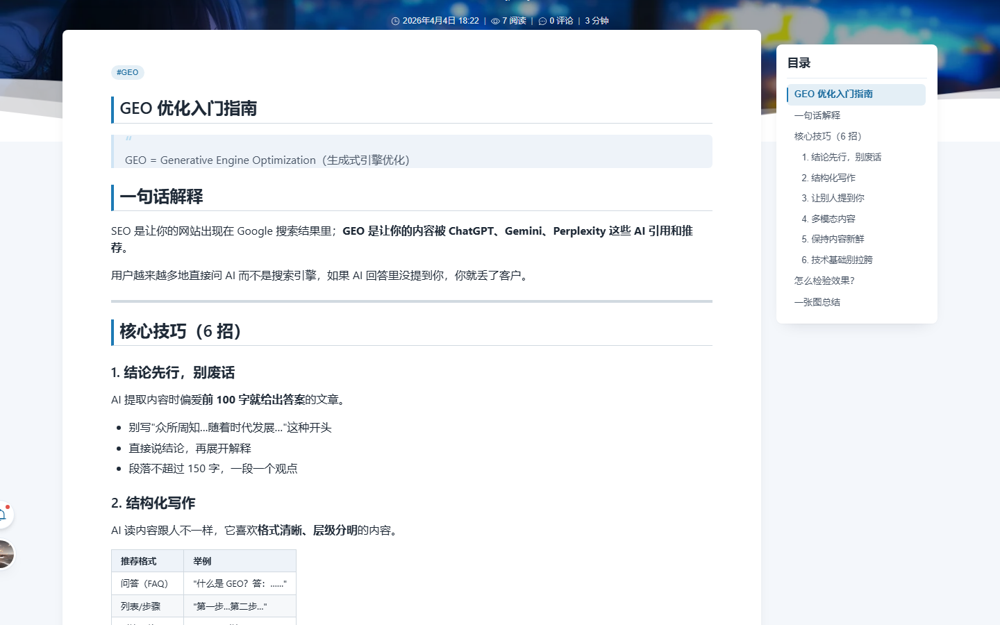</td>
  </tr>
  <tr>
    <td width="50%">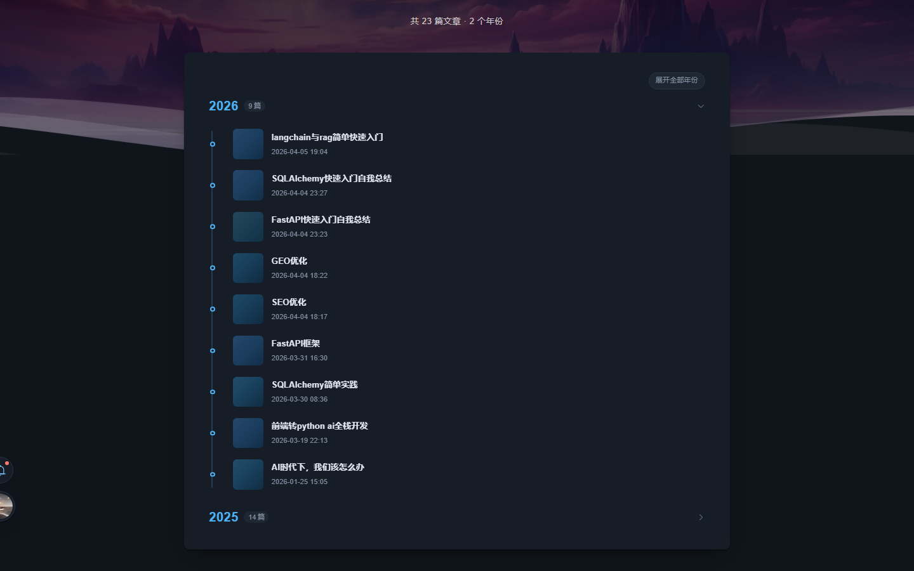</td>
    <td width="50%">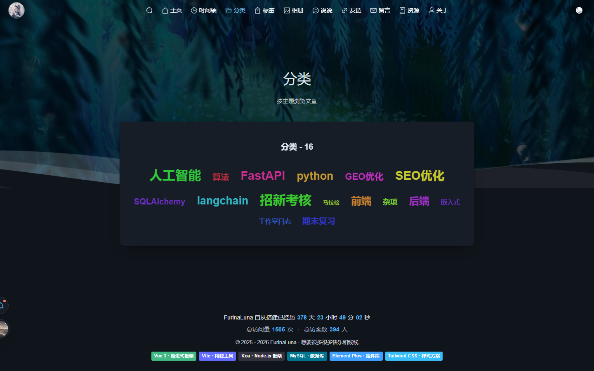</td>
  </tr>
  <tr>
    <td width="50%">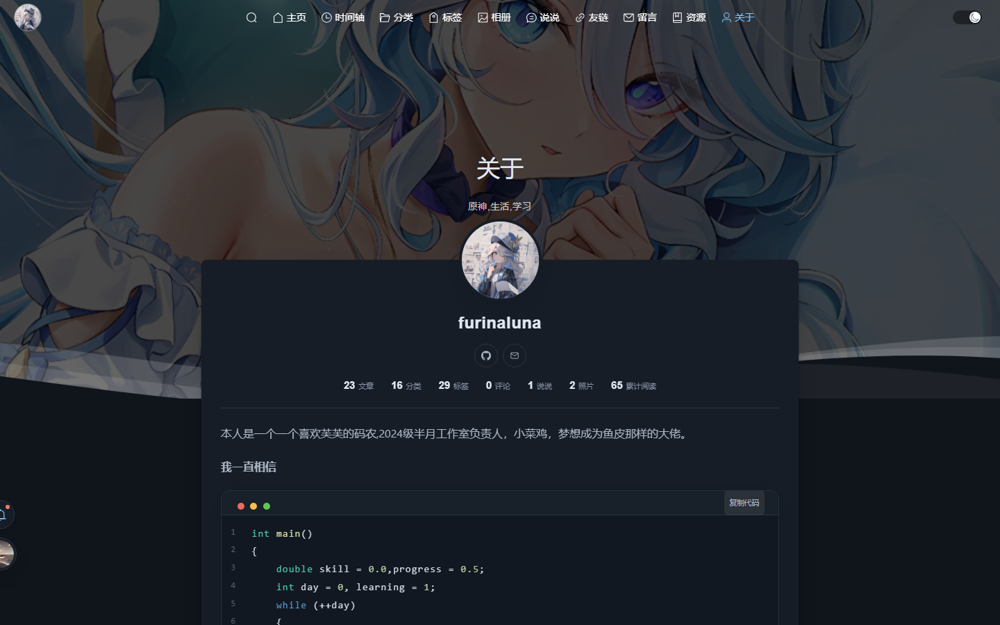</td>
    <td width="50%">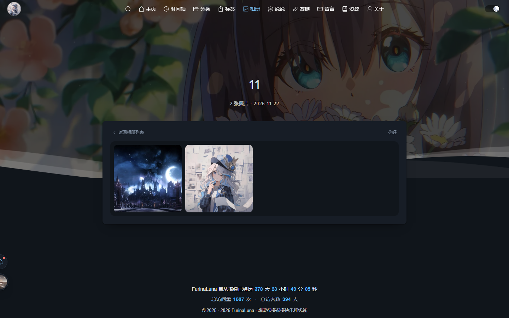</td>
  </tr>
  <tr>
    <td width="50%">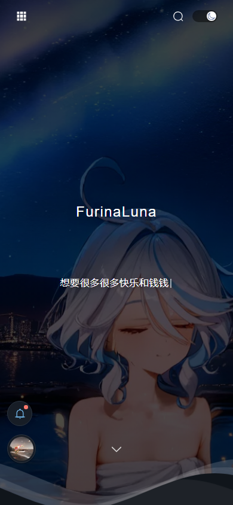</td>
    <td width="50%">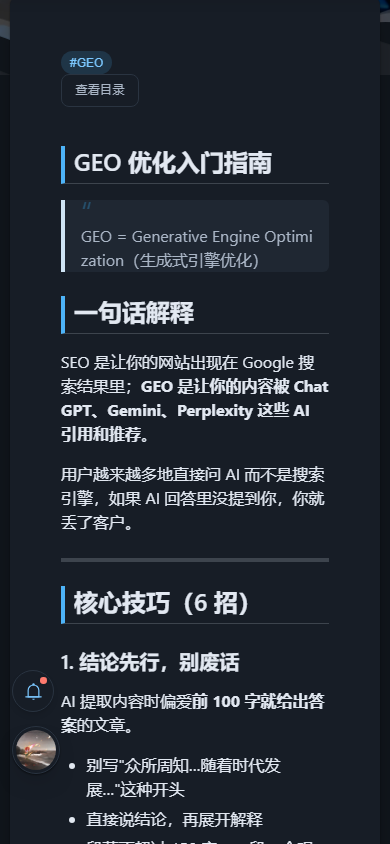</td>
  </tr>
  <tr>
    <td width="50%">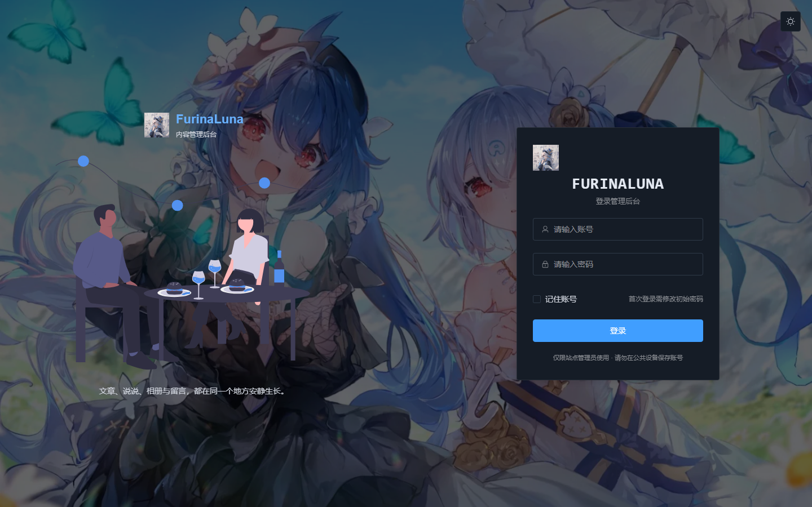</td>
    <td width="50%">移动端已按 <b>390×844</b> 适配：字号 15px、正文 1.75 倍行距、按钮点按区 ≥48px、表格横向滚动不破版。</td>
  </tr>
</table>

## 🧱 技术栈

| 层 | 技术 |
| --- | --- |
| 前台 `blog-web` | Vue 3.5 · Vite 8 · TypeScript · Vue Router 5 · Pinia 4 · Element Plus 2.14 · Tailwind CSS 4 · md-editor-v3 7 · vue3-danmaku |
| 后台 `blog-admin` | 同上前端栈 + highlight.js · KaTeX · Mermaid · Cropper.js · Screenfull（Markdown 编辑器与图片裁剪） |
| 服务端 `blog-server` | Node.js ≥22.12 · Koa 3 · @koa/router 15 · Sequelize 6 · mysql2 · zod 4 · JWT（jsonwebtoken 9）· bcryptjs |
| 数据库 | MySQL 8.0（utf8mb4，Docker 命名卷持久化） |
| 部署 | Docker Compose（web / api / db 三容器）· Nginx · GitHub Actions · GHCR 镜像 · systemd 备份与健康检查定时器 |

## 🏗 架构

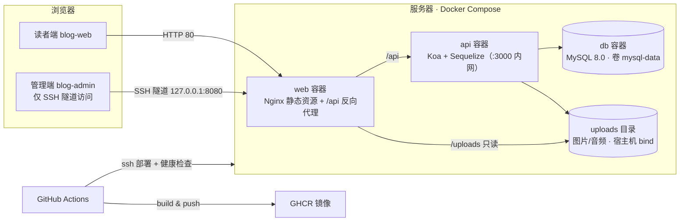

- 前台 `/` 与后台 `/admin/` 由同一个 Nginx 容器托管，`/api`、`/uploads`、`/rss.xml`、`/sitemap.xml` 反向代理到 API 容器。
- 管理后台默认只监听 `127.0.0.1:8080`，公网 80 端口对 `/admin/`、`/api/admin/` 直接 403，只能经 SSH 隧道进入。
- 数据库与上传目录都是「命名卷 / 宿主机目录」，重建容器不丢数据；备份脚本用容器内 `mysqldump`。

## 📁 目录结构

```text
luna-blog/
├─ blog-web/            # 前台（Vue 3 + Vite + TS）
│  ├─ src/api/          # 请求封装与类型
│  ├─ src/components/   # 通用组件（页头、目录、评论、音乐球…）
│  ├─ src/views/        # 页面（首页/文章/归档/分类/相册/留言/关于…）
│  ├─ src/utils/seo.ts  # TDK / OG / JSON-LD / canonical 统一出口
│  └─ src/styles/       # 全局样式与暗色/移动端适配
├─ blog-admin/          # 后台（Vue 3 + Vite + TS + Element Plus）
│  └─ src/views/        # 仪表盘、文章、评论、站点配置、通知中心…
├─ blog-server/         # API（Koa 3 + Sequelize 6）
│  ├─ src/modules/      # article / comment / album / seo / site / visit…
│  ├─ src/middleware/   # 鉴权、限频、错误处理、上传
│  └─ scripts/          # init-db / check
├─ docker/              # api.Dockerfile · web.Dockerfile · nginx.conf · env 样例
├─ deploy/              # docker-compose.yml · ops 脚本 · systemd 单元
├─ docs/                # 设计 / 接口 / 运维 / 原型 / 项目评审
└─ .github/workflows/   # deploy-docker.yml（构建推送 + 自动发布）
```

## 🚀 本地运行

环境要求：**Node.js ≥ 22.12**、**pnpm ≥ 10**、MySQL 8.0。

```bash
# 1. 安装依赖（三个包各自安装）
pnpm -C blog-web install
pnpm -C blog-admin install
pnpm -C blog-server install

# 2. 配置服务端环境变量
cp blog-server/.env.example blog-server/.env
# 按需修改 DB_*、JWT_SECRET、ADMIN_USERNAME / ADMIN_PASSWORD

# 3. 初始化数据库（建库建表 + 管理员 + 示例数据）
pnpm -C blog-server run db:init

# 4. 分别启动
pnpm -C blog-server start        # API  http://localhost:3000
pnpm -C blog-web dev             # 前台 http://localhost:5173
pnpm -C blog-admin dev           # 后台 http://localhost:5174
```

> 本地开发时前台通过 Vite 代理访问 `/api`，默认指向 `http://127.0.0.1:3000`。

## 🐳 部署（Docker Compose）

服务器只需 Docker Engine + Compose 插件，仓库自带 `deploy/docker-compose.yml`：

```bash
# 服务器上的目录布局
/var/www/luna-blog/
├─ docker-compose.yml     # 来自 deploy/docker-compose.yml
├─ compose.env            # MYSQL_ROOT_PASSWORD / DB_* / IMAGE 标签
├─ api.env                # 来自 docker/api.env.example
├─ data/uploads/          # 上传文件（bind 挂载）
└─ src/                   # 仓库源码（构建上下文）
```

```bash
# 首次部署
docker compose --env-file compose.env up -d --build

# 日常发布：CI 构建镜像后由服务器执行
docker compose --env-file compose.env pull
docker compose --env-file compose.env up -d
curl -fsS http://127.0.0.1/api/health
```

镜像流水线（`.github/workflows/deploy-docker.yml`）：

1. `push` 到 `main`（前端/后端/Docker 相关路径）
2. buildx 构建并推送 `ghcr.io/furinaluna/luna-blog-{web,api}:<日期-序号>`
3. SSH 到服务器执行发布脚本：`pull → up -d → 健康检查`，失败**自动回滚**到上一镜像
4. 历史镜像保留，回滚只需带上旧 tag

运维配套：每天 `03:30` 自动备份数据库与上传目录；每分钟健康检查，异常自动重启 `api`/`web` 容器。细节见 [运维手册](docs/ops/RUNBOOK.md)。

## 🔍 SEO / GEO 支持

不只是「能看」，还让搜索引擎与 AI 回答引擎「读得懂」：

- 每页独立 **TDK**、canonical、`og:*`/`twitter:*`、`article:published_time` 等结构化 meta
- 结构化数据：`BlogPosting` + `BreadcrumbList`（文章）、`WebSite` + `SearchAction`（首页）、`ProfilePage` + `Person`（关于页）
- 正文只保留一个 `H1`；图片全部带 `alt` 与非首屏 `loading="lazy"`
- 机器可读入口：
  - `/robots.txt`：显式放行 GPTBot、ClaudeBot、PerplexityBot、Google-Extended 等 17 个 AI 爬虫
  - `/sitemap.xml`：静态页 + 文章 + 封面图
  - `/llms.txt`：站点信息、栏目与最近文章列表
  - `/md/<id>`：文章 Markdown 全文（`text/markdown`），供 AI 直接抓取

> 单页应用（SPA）对不执行 JavaScript 的爬虫不友好，因此额外提供 `/llms.txt` 与 `/md/:id`；如需搜索引擎直接读到正文，可在此基础上加预渲染（当前未启用）。

## 📚 文档

| 文档 | 内容 |
| --- | --- |
| [docs/API.md](docs/API.md) | 全部公开 / 管理接口、字段与错误码 |
| [docs/DESIGN.md](docs/DESIGN.md) | 视觉与交互设计、组件约定、主题变量 |
| [docs/ops/RUNBOOK.md](docs/ops/RUNBOOK.md) | 生产形态、发布/回滚、备份恢复、故障排查 |
| [docs/PROJECT-REVIEW.md](docs/PROJECT-REVIEW.md) | 项目评审与整改记录 |
| [docs/PROTOTYPE-web.md](docs/PROTOTYPE-web.md) · [PROTOTYPE-admin.md](docs/PROTOTYPE-admin.md) | 前台 / 后台原型说明 |

## 🗺 Roadmap

- [x] 三端分离重构（前台 / 后台 / API）
- [x] Markdown 文章、评论审核、留言板、相册、说说、友链、资源
- [x] 站点配置化（横幅、资料卡、社交、音乐、欢迎语、登录页背景）
- [x] Docker Compose 部署 + GitHub Actions 自动发布
- [x] SEO / GEO：结构化数据、Sitemap、llms.txt、Markdown 直出、移动端适配
- [ ] 域名备案后启用 HTTPS（证书 + 301 + `SITE_URL`）
- [ ] 图片 CDN / 对象存储（当前本地磁盘）
- [ ] 全文检索（当前为标题/摘要 LIKE 搜索）

## 🤝 贡献

这是一个个人博客项目，不追求通用化，但欢迎提 Issue 讨论思路或报 Bug。提交前请确保 `pnpm -C blog-web build`、`pnpm -C blog-admin build`、`pnpm -C blog-server run build` 均通过。

## 📄 License

[MIT](LICENSE) © 2024-2026 FurinaLuna
